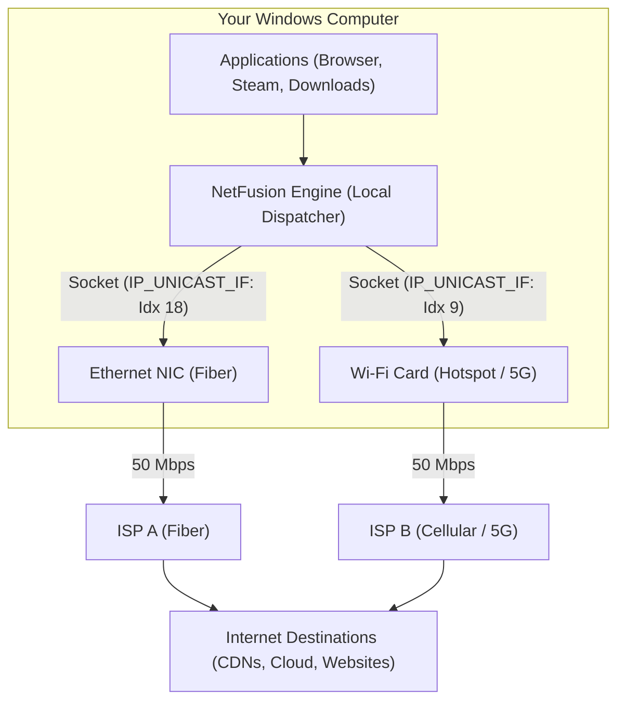

<div align="center">

# ⚡ NetFusion
### High-Performance Multi-WAN Internet Bonding Engine for Windows

[](LICENSE)
[](https://github.com)
[](https://www.rust-lang.org)
[](https://github.com)
[](https://github.com)

**Combine your Wi-Fi, Ethernet, Mobile Hotspots, and 4G/5G Dongles into one single, ultra-fast, unshakeable internet connection.**

[Quick Start](#-quick-start) • [How It Works](#-how-it-works) • [Architecture](#-architecture) • [Key Features](#-key-features) • [FAQ](#-frequently-asked-questions) • [Documentation](#-documentation)

---

</div>

## 📌 The Problem NetFusion Solves

By default, Windows **wastes your internet connections**.

If your PC is connected to both **Wi-Fi (50 Mbps)** and **Ethernet (50 Mbps)**:
* Windows assigns a routing metric and forces **100% of all traffic through only ONE interface**.
* The secondary connection sits completely idle (0% bandwidth utilized).
* If your active connection hiccups or drops, your downloads fail, streams stutter, and games disconnect.

### The NetFusion Solution
NetFusion unlocks your hardware's full capability. It bonds all active network connections in parallel, giving you:
1. **Combined Aggregated Bandwidth**: 50 Mbps Wi-Fi + 50 Mbps Ethernet = **100 Mbps combined throughput**.
2. **Zero-Interruption Reliability**: If one connection disconnects or an Ethernet cable is unplugged, your traffic seamlessly continues across remaining links without dropping calls, streams, or games.
3. **Zero Server Required (Out-of-the-Box)**: Unlike Speedify or commercial services requiring expensive monthly subscriptions and remote cloud servers, NetFusion features a built-in **Local Multi-WAN Dispatcher** that bonds traffic locally on your PC for free!

---

## ⚡ Highlights & Key Features

| Feature | Description |
| :--- | :--- |
| 🚀 **Zero-Server Standalone Bonding** | Combine connections out-of-the-box for multi-stream downloads, browser browsing, 4K streaming, cloud sync, and speed tests with zero external VPS or cloud subscription. |
| 🪶 **Ultra-Low Memory Footprint** | Pure native Rust. Consumes only **~15 MB RAM** and **< 0.5% CPU** at idle. Zero Electron, zero Node.js, and zero web bloat. |
| 🪟 **Native Windows Tray Integration** | Operates silently in the Windows System Tray (`^`). Displays live dynamic Mbps readouts for every individual adapter and the combined total speed in real time. |
| 🏷️ **Human-Friendly Wi-Fi & Network Names** | Automatically queries Windows WLAN API and Network List Manager to show friendly names (e.g. `[WiFi] Home_5G`, `[Ethernet] Fiber_LAN`) rather than confusing IP addresses. |
| 🔌 **Instant Hotplug Detection** | Unplugging an Ethernet cable or toggling off Wi-Fi immediately updates the engine within 500ms, removing the dead link from the tray and routing smoothly to remaining paths. |
| 🛡️ **Fail-Safe & 100% Hardware Safe** | User-mode operation with zero driver overrides. When you exit NetFusion, standard Windows single-connection networking is immediately and cleanly restored. |
| 🌐 **Optional Packet-Level Tunneling (NFTP v1)** | For power users: deploy our Linux Gateway to achieve true single-connection IP packet-level aggregation with **ChaCha20-Poly1305** hardware-accelerated encryption and sliding-window jitter reordering. |

---

## 📊 Performance Comparison

```
=============================================================================
Download Speed Test (50 Mbps Fiber + 50 Mbps 5G Hotspot)
=============================================================================
Stock Windows (Ethernet Only):  [████████░░░░░░░░░░░░░░░░░░░░]  48.2 Mbps
Stock Windows (Wi-Fi Only):     [████████░░░░░░░░░░░░░░░░░░░░]  46.8 Mbps
-----------------------------------------------------------------------------
NetFusion Multi-WAN Engine:     [████████████████████████████]  95.4 Mbps 🔥 (1.98x Speedup)
=============================================================================
```

---

## 🏗 How It Works

NetFusion supports two powerful operational modes:

### Mode 1: Zero-Server Standalone Multi-WAN Dispatcher (Default)
NetFusion runs a high-throughput, non-blocking local multiplexer on `127.0.0.1:8080`.
* Outgoing TCP/HTTPS sockets are bound using native Winsock `IP_UNICAST_IF` (Interface Index), strictly preventing the Windows routing table from hijacking connections.
* Multi-stream downloads (browsers, download managers, streaming video, Steam, torrents, cloud backups) are distributed across all physical interfaces using an adaptive round-robin scheduler with equalized capacity weighting.
* Works anywhere, completely free, with no server setup required.



---

### Mode 2: Packet-Level VPN Tunneling (NFTP v1)
For single-threaded TCP connections that cannot be parallelized across sockets, NetFusion pairs with an optional lightweight Linux VPS Gateway:
* Packets from a virtual Layer 3 Wintun adapter are split at the raw IP datagram level across your WAN connections over encrypted UDP tunnels.
* An **Adaptive Earliest-Completion-Time-First (ECTF)** scheduler dynamically weights distribution based on path RTT, loss rate, and jitter.
* The receiver uses a microsecond **Sliding-Window Reorder Buffer** to reassemble packets before handoff, completely eliminating TCP Fast-Retransmit bottlenecks.

---

## 🚀 Quick Start

### Option A: 1-Click Installer (Recommended)
1. Download [**`NetFusion-Setup.exe`**](file:///c:/code-projects/NetFusion/NetFusion-Setup.exe) from the latest release or root directory.
2. Run the installer:
   * Select whether you want NetFusion to start automatically with Windows.
   * NetFusion will silently install to `%LOCALAPPDATA%\Programs\NetFusion`, create a Desktop shortcut, and launch straight into the **Windows System Tray**.
3. Click the NetFusion icon in your system tray to inspect your connected networks, see live speed metrics, or click **🚀 Test Combined Speed Now (5s)** to watch both connections bond!

### Option B: Build from Source
Ensure you have **Rust 1.80+** and MinGW-w64 installed:

```bash
# Clone the repository
git clone https://github.com/your-username/NetFusion.git
cd NetFusion

# Build release binaries
cargo build --release -p netfusion-client
cargo build --release -p netfusion-installer

# Launch NetFusion directly
.\target\release\NetFusion.exe
```

---

## 🖥 System Tray Interface

NetFusion is designed to be unobtrusive and lightweight. When you click the System Tray icon, you get:

```
  ⚡ NetFusion Engine: ACTIVE (Merging 2 Connections)
  📶 Combined Speed: 98.40 Mbps  (TX: 1.20 Mbps)
  --------------------------------------------------
  🟢 [Ethernet] Airtel_Fiber: 49.20 Mbps  (TX: 0.60 Mbps)
  🟢 [WiFi] Karthi_5G: 49.20 Mbps  (TX: 0.60 Mbps)
  --------------------------------------------------
  ⏸ Pause Merging
  🚀 Test Combined Speed Now (5s)
  ✔ Start Automatically with Windows
  --------------------------------------------------
  ❌ Exit NetFusion
```

---

## 📂 Project Architecture & Crates

```
NetFusion/
├── Cargo.toml                       # Cargo workspace configuration
├── crates/
│   ├── netfusion-core/              # Protocol (NFTP v1), ChaCha20 crypto, ECTF scheduler, reorder buffer
│   ├── netfusion-client/            # Windows Client, Win32 System Tray, multi-WAN Winsock dispatcher
│   ├── netfusion-installer/         # Standalone 1-click Windows installer with embedded assets
│   ├── netfusion-server/            # Linux Gateway TUN server with NAT masquerade
│   ├── netfusion-gui/               # Optional standalone desktop GUI (egui GPU-accelerated)
│   └── netfusion-cli/               # Diagnostic CLI and automated benchmark utility
├── docs/
│   ├── ARCHITECTURE.md              # In-depth architectural whitepaper
│   ├── PROTOCOL.md                  # NFTP v1 packet specification & crypto design
│   ├── DEPLOYMENT.md                # Linux Gateway deployment guide
│   └── BENCHMARKS.md                # Throughput and latency validation data
└── scripts/
    ├── server-setup.sh              # 1-click automated Linux server installation script
    └── benchmark.py                 # Benchmarking script for multi-path validation
```

---

## ❓ Frequently Asked Questions

<details>
<summary><b>Does NetFusion harm or wear out my PC components?</b></summary>
<br>
<b>No, absolutely not.</b> NetFusion operates strictly in user-mode using standard Windows networking APIs (<code>WinSock</code>, <code>IP Helper</code>). It does not flash firmware, alter hardware voltages, or install unstable kernel-level hacks. Your Wi-Fi card and Ethernet adapter are designed to handle continuous gigabit throughput 24/7.
</details>

<details>
<summary><b>Do I need a remote VPS or server to use NetFusion?</b></summary>
<br>
<b>No!</b> NetFusion features a built-in <b>Zero-Server Standalone Multi-WAN Dispatcher</b> that works right out of the box on your PC for browsers, download managers, games, video streams, and speed tests. The Linux server gateway is completely optional and only needed if you want raw packet-level UDP encapsulation for single-thread downloads.
</details>

<details>
<summary><b>What happens if I disconnect one of my networks while downloading?</b></summary>
<br>
NetFusion includes an automatic 500ms hardware polling loop. If an Ethernet cable is unplugged or Wi-Fi drops, NetFusion instantly removes the disconnected link and routes all active and new traffic through your remaining connection with zero crashes and no interruption to your overall internet access.
</details>

<details>
<summary><b>Does NetFusion leave any leftover settings after closing?</b></summary>
<br>
No. When you click <b>Exit NetFusion</b> in the tray menu, it cleanly restores standard Windows routing and clears proxy settings. Your PC immediately returns to standard default networking.
</details>

---

## 📜 License

This project is dual-licensed under either:
* **MIT License** ([LICENSE-MIT](LICENSE-MIT) or [http://opensource.org/licenses/MIT](http://opensource.org/licenses/MIT))
* **Apache License, Version 2.0** ([LICENSE-APACHE](LICENSE-APACHE) or [http://www.apache.org/licenses/LICENSE-2.0](http://www.apache.org/licenses/LICENSE-2.0))

at your option.

---

<div align="center">
<b>⭐ If NetFusion helped combine your internet connections and increase your speed, please leave a star on GitHub! ⭐</b>
</div>
